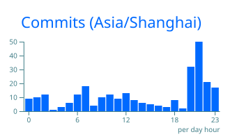

# Iron Tom

**UNRAVEL BEYOND BOUNDARIES**

From Kernel to Pixels · 从内核到像素

Building software, exploring AI agents, and learning how systems work.

## Personal Blog

<table>
<tr>
<td width="100%">

### 📖 Iron Tom's Blog

**Notes · Ideas · Engineering**

A place to document what I learn, build, and discover — from software engineering and computer science to AI-assisted development.

**[Visit the Blog →](https://unraveltao.github.io/)**

</td>
</tr>
</table>

## Featured Projects

<table>
<tr>
<td width="50%" valign="top">

### 🧩 [Lattice](https://github.com/unraveltao/Lattice)

**Desktop Agent & Plugin Platform**

An extensible desktop platform exploring AI agents, plugins, permissions, and developer workflows.

`Rust` · `React` · `Tauri`

**[View Repository →](https://github.com/unraveltao/Lattice)**

</td>
<td width="50%" valign="top">

### 🛠️ [Skills](https://github.com/unraveltao/Skills)

**Reusable AI Skills & Workflows**

A collection of reusable skills for AI-assisted software development, learning, research, and automation.

`AI Agents` · `Workflows` · `Automation`

**[View Repository →](https://github.com/unraveltao/Skills)**

</td>
</tr>
</table>

More experiments and repositories: [Explore all repositories](https://github.com/unraveltao?tab=repositories).

## Tech Stack & Tools

Tools I use to learn, build, and ship software. SVG badges use recognizable brand marks; Codex and GitHub Projects use their parent brand marks.

### Languages & Frameworks

  
  
  
  
  
  

### AI & Agents

  
  
  
  

### Development Tools

  
  
  
  
  
  

### Project & Design

  
  
  

### Knowledge & Research

  
  

<!-- SVG badges are hosted by shields.io. Firecrawl currently uses a text-only SVG badge until its official logo asset is verified. -->

## Activity

Generated by GitHub Actions, refreshed daily. Everything above this line is plain text.

  
  

  <picture>
    <source media="(prefers-color-scheme: dark)" srcset="https://raw.githubusercontent.com/unraveltao/unraveltao/output/github-snake-dark.svg">
    <source media="(prefers-color-scheme: light)" srcset="https://raw.githubusercontent.com/unraveltao/unraveltao/output/github-snake.svg">
    
  </picture>

## Contact

**irontom233@gmail.com** — the fastest way to reach me.

[Email](mailto:irontom233@gmail.com) · [X @iron_tom233](https://x.com/iron_tom233) · [GitHub](https://github.com/unraveltao)
