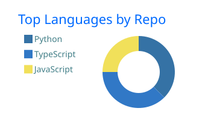

# Iron Tom

desktop software, end to end · 从内核到像素

I build desktop apps — Rust core, React shell, and the pixels in between.

## Lattice · 棂

**Your own widgets on the Windows desktop — a widget is just a web page.**

棂 —— 你自己的桌面小组件。一个组件，就是一个网页。

<!-- 截图位：把 assets/lattice.png 放进来，然后删掉下面这行的注释符

-->

- **17 widgets, none built in.** Every official widget installs through the same path as a third-party one — the app ships empty.
- **Sandboxed by default.** Widgets run in opaque-origin iframes with 12 permissions, none granted until you approve them.
- **22K lines of TypeScript over 23K lines of Rust.** A Tauri 2 shell sharing the system WebView2, not one Chromium per widget.

[Repository](https://github.com/unraveltao/lattice) · [Releases](https://github.com/unraveltao/lattice/releases) · MIT

## Now

- Building **Lattice** full time — the widget platform above, currently pre-1.0.
- Going deeper on **Rust, WebView2, and sandboxed permission models**.
- Open to **remote roles and collaboration** on desktop or developer-tool projects.

## Selected work

- **[lattice](https://github.com/unraveltao/lattice)** — widget platform for Windows. Tauri 2 · React 19 · Rust · MIT
- **[Notes](https://github.com/unraveltao/Notes)** — working notes on systems, tooling and the web.
- **[blog.github.io](https://unraveltao.github.io/)** — personal blog, still being built.

## Tech Stack & Tools

Tools I use to learn, build, and ship software. SVG badges use recognizable brand marks; Codex and GitHub Projects use their parent brand marks.

### Languages & Frameworks

  
  
  
  
  
  

### AI & Agents

  
  
  
  

### Development Tools

  
  
  
  
  
  

### Project & Design

  
  
  

### Knowledge & Research

  
  

<!-- SVG badges are hosted by shields.io. Firecrawl currently uses a text-only SVG badge until its official logo asset is verified. -->

## Activity

Generated by GitHub Actions, refreshed daily. Everything above this line is plain text.

  
  

  <picture>
    <source media="(prefers-color-scheme: dark)" srcset="https://raw.githubusercontent.com/unraveltao/unraveltao/output/github-snake-dark.svg">
    <source media="(prefers-color-scheme: light)" srcset="https://raw.githubusercontent.com/unraveltao/unraveltao/output/github-snake.svg">
    
  </picture>

## Contact

**irontom233@gmail.com** — the fastest way to reach me.

[Email](mailto:irontom233@gmail.com) · [X @iron_tom233](https://x.com/iron_tom233) · [GitHub](https://github.com/unraveltao)
