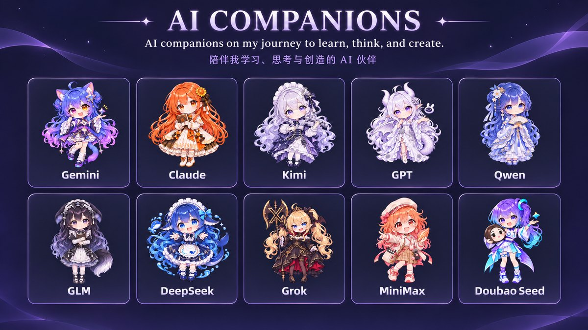
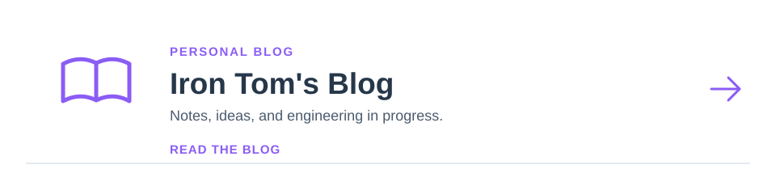
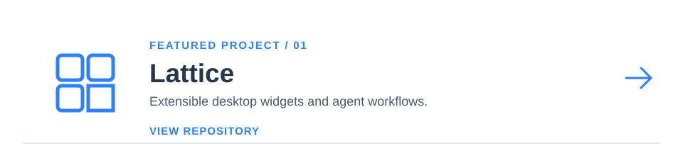
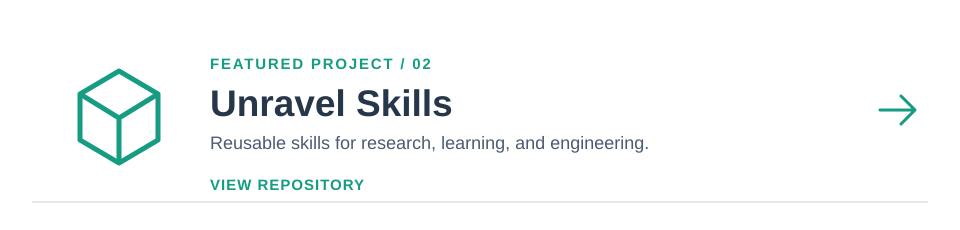
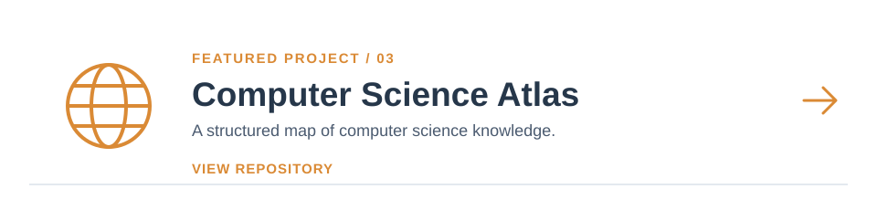
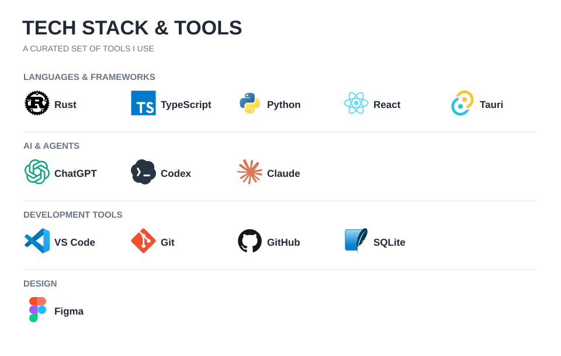
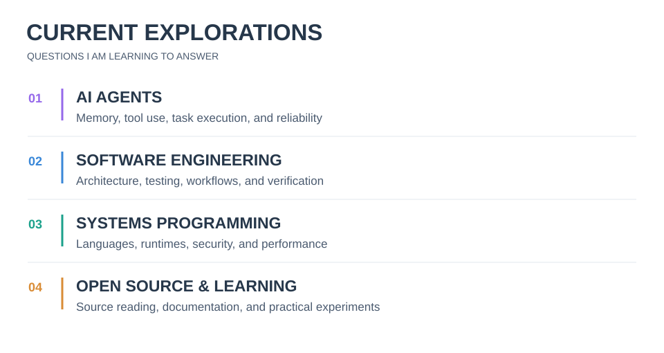
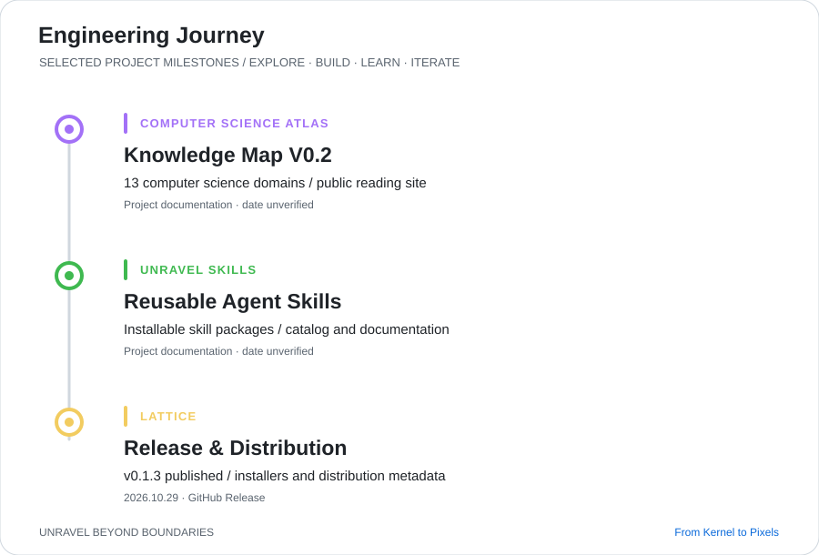

  

# Iron Tom

**UNRAVEL BEYOND BOUNDARIES**

From Kernel to Pixels · 从内核到像素

Independent developer · Open-source builder · Lifelong learner

## About Me

I'm an independent developer and a computer science learner who enjoys understanding how software works, from the foundations of programming languages to the design of practical tools.

I learn by building: reading source code, experimenting with architectures, documenting what I discover, and turning repeated workflows into reusable tools. My current work connects **desktop applications**, **AI agents**, **software engineering**, and **open-source knowledge sharing**.

I care about maintainable systems, clear boundaries, and results that can be tested rather than merely demonstrated. This profile is a living record of what I'm building and learning.

  

## Personal Blog

<a href="https://unraveltao.github.io/">
<picture>
  <source media="(prefers-color-scheme: dark)" srcset="./assets/banners/blog-dark.svg">
  
</picture>
</a>

A home for engineering notes, experiments, and reflections on learning computer science. I use it to connect ideas from real projects with the principles behind them.

**[Visit the blog](https://unraveltao.github.io/)**

## Featured Projects

<a href="https://github.com/unraveltao/Lattice">
<picture>
  <source media="(prefers-color-scheme: dark)" srcset="./assets/banners/lattice-dark.svg">
  
</picture>
</a>

**Lattice — desktop agent and plugin platform** · `Rust` · `React` · `Tauri`

Building an extensible desktop environment for widgets, plugins, permissions, and agent-assisted workflows. My engineering focus includes safe tool authorization, recoverable execution, and a maintainable boundary between the desktop shell and agent capabilities.

**Status:** In active development. A verified [v0.1.3 release](https://github.com/unraveltao/Lattice/releases/tag/v0.1.3) is available; later development milestones are not presented as published releases.

<a href="https://github.com/unraveltao/Skills">
<picture>
  <source media="(prefers-color-scheme: dark)" srcset="./assets/banners/skills-dark.svg">
  
</picture>
</a>

**Unravel Skills — reusable agent skills and workflows** · `AI Agents` · `Automation`

A collection of independently installable skills for learning, research, engineering, and repeatable tasks. The goal is to turn useful practices into understandable, reusable workflows rather than reinventing the process every time.

**Explore:** [Source repository](https://github.com/unraveltao/Skills) · [Skills catalog](https://unraveltao.github.io/Skills/)

<a href="https://github.com/unraveltao/Computer-Science-Atlas">
<picture>
  <source media="(prefers-color-scheme: dark)" srcset="./assets/banners/atlas-dark.svg">
  
</picture>
</a>

**Computer Science Atlas — a structured learning map** · `Markdown` · `Quartz`

Organizing computer science knowledge into a navigable collection of notes and connections across **13 subject areas**. It is both a learning resource and an experiment in building a maintainable knowledge system.

**Explore:** [Source repository](https://github.com/unraveltao/Computer-Science-Atlas) · [Knowledge site](https://unraveltao.github.io/Computer-Science-Atlas/)

[Browse all repositories](https://github.com/unraveltao?tab=repositories)

## Tech Stack & Tools

A focused selection of languages, frameworks, and tools I use in development and learning. Logos are embedded from established open-source icon libraries; the artwork is not recreated from text placeholders.

<picture>
  <source media="(prefers-color-scheme: dark)" srcset="./assets/banners/tech-stack-dark.svg">
  
</picture>

## Engineering Journey

I approach projects as a cycle of **explore → build → test → document → improve**. Along the way, I'm learning how to move from a working prototype to software that other people can understand, verify, and use.

### What I'm Exploring

<picture>
  <source media="(prefers-color-scheme: dark)" srcset="./assets/banners/explorations-dark.svg">
  
</picture>

These topics reinforce each other: agent reliability benefits from sound software architecture; systems programming clarifies performance and safety trade-offs; source reading and documentation help turn experiments into durable knowledge.

### Development Milestones

Selected public outcomes, with dates stated only where they can be verified.

**Evidence:** [Computer Science Atlas](https://github.com/unraveltao/Computer-Science-Atlas) · [Unravel Skills](https://github.com/unraveltao/Skills) · [Lattice v0.1.3 release](https://github.com/unraveltao/Lattice/releases/tag/v0.1.3)

The Atlas and Skills milestone dates are not yet verified. Ongoing work and future plans are not labeled as completed releases.

## Connect

If you're interested in open-source engineering, AI agents, or learning by building, feel free to reach out.

**Email:** [irontom233@gmail.com](mailto:irontom233@gmail.com) · **[GitHub](https://github.com/unraveltao)** · **[X](https://x.com/iron_tom233)** · **[Blog](https://unraveltao.github.io/)**

<!-- Visual sources: devicons/devicon and lobehub/lobe-icons. Banner compositions are original SVG layouts. -->
